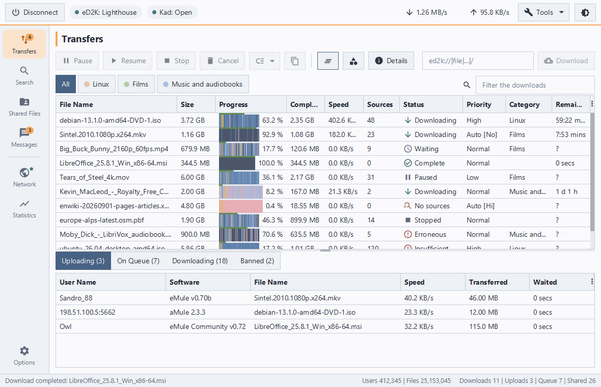

<!--
SPDX-FileCopyrightText: 2026 Salvatore Coppola and the njMule contributors
SPDX-License-Identifier: GPL-3.0-or-later
-->
<p align="center"></p>

<h1 align="center">njMule</h1>

<p align="center">
    <strong>Next generation Java Mule</strong> — a modern, open-source client for the eD2K and Kad
    file-sharing networks, written in Java 25.
</p>

<p align="center">
    <a href="https://github.com/njMule/njMule/actions/workflows/build.yml"></a>
    <a href="https://sonarcloud.io/summary/new_code?id=njMule_njMule"></a>
    <a href="https://sonarcloud.io/summary/new_code?id=njMule_njMule"></a>
    <a href="LICENSE"></a>
    <a href="https://openjdk.org/projects/jdk/25/"></a>
    <a href="#download-and-install"></a>
</p>

<p align="center">
    <a href="#features">Features</a> ·
    <a href="#download-and-install">Download</a> ·
    <a href="#usage">Usage</a> ·
    <a href="#building-from-source">Build</a> ·
    <a href="#contributing">Contribute</a> ·
    <a href="CHANGELOG.md">Changelog</a>
</p>

<p align="center">
    <picture>
        <source media="(prefers-color-scheme: dark)" srcset=".github/assets/njmule-transfers-dark.png">
        
    </picture>
</p>

> [!WARNING]
> **Pre-alpha (`0.0.1-alpha.1`).** No release has been published yet: the packages described
> below are produced by the release workflow and will be attached to the first
> [GitHub release](https://github.com/njMule/njMule/releases). Features and settings may still
> change before 1.0.0.

## Why njMule?

- 🔌 **Wire-compatible** — speaks eD2K and Kad 2, so it works with the existing eMule network.
- 📦 **Nothing to install first** — GraalVM native executables and installers for Windows, macOS
  and Linux; no Java runtime is required.
- 🛡️ **Hardened by design** — size-limited parsers for all input from the network and from disk,
  and crash-safe persistence.
- 🖥️ **Desktop, headless or remote** — a JavaFX app, a command-line engine, a web interface and a
  JSON API, all driving the same GUI-independent core built on virtual threads.

## Features

| | |
|---|---|
| 🌐 **eD2K** | Server connections with optional protocol obfuscation, static servers, a starting server list shipped with njMule and `server.met` updates from a URL. Searches on the connected server, on all known servers over UDP or on Kad, filtered by file type, size, availability and extension. Downloads verified part by part, with corrupt parts repaired from AICH recovery data. Uploads through a credit-scored queue, with secure identification and source exchange. |
| 🕸️ **Kad 2** | Routing table, keyword and source lookups, publishing of shared files, firewall check, bootstrap from the contacts shipped with njMule or from a `nodes.dat` URL. |
| 📂 **File management** | Shared directories with recursive sharing and change monitoring; download and upload priorities, categories, preview in an external video player, comments and ratings. |
| 🖥️ **Desktop app** | JavaFX with AtlantaFX themes (Nord light and dark by default, following the system, and the system colours under Windows high contrast), 36 languages including right-to-left ones with a mirrored layout, system tray integration and optional registration as the `ed2k://` link handler. |
| 🌍 **Web interface** | Status, transfers, searches and servers, protected by a password. |
| 🔧 **Networking** | SOCKS 4/5 and HTTP CONNECT proxies, binding to one network interface (such as a VPN) that keeps njMule offline while it is gone, UPnP port forwarding, IP filtering (`ipfilter.dat`, PeerGuardian, P2B) with updates from a URL, and a weekly scheduler for bandwidth limits and categories. |
| 💬 **Messaging** | Chat with CAPTCHA verification, a friends list and spam filters. |

<details>
<summary>The 36 languages of the desktop application</summary>

English, Catalan, Czech, Danish, German, Estonian, Spanish, French, Galician, Italian, Latvian,
Lithuanian, Hungarian, Dutch, Norwegian Bokmål, Polish, Brazilian and European Portuguese,
Romanian, Albanian, Slovenian, Finnish, Swedish, Vietnamese, Turkish, Greek, Bulgarian, Russian,
Ukrainian, Arabic, Persian, Hebrew, Simplified and Traditional Chinese, Japanese and Korean.

</details>

## Download and install

| Operating system | Architecture | Formats |
|---|---|---|
| 🪟 Windows | x64 (arm64 through the system's x64 emulation) | `.msi` installer, `.zip` archive |
| 🐧 Linux | x64, arm64 | `.deb`, `.rpm`, `.tar.gz` archive |
| 🍎 macOS 13 or later | Apple silicon (arm64) | `.dmg` disk image |

Every package contains two executables: **`njmule-gui`**, the desktop application, and
**`njmule`**, the command-line interface, which also runs the engine headless. Each release also
provides a `SHA256SUMS` file and a CycloneDX software bill of materials
(`njmule-<version>-sbom.cdx.json`). Verify the downloaded files with:

```bash
sha256sum --check --ignore-missing SHA256SUMS
```

<details>
<summary><strong>Windows</strong></summary>

The MSI performs a per-user installation and requires no administrator rights. It installs the
executables in `%LOCALAPPDATA%\Programs\njMule`, creates Start menu and desktop shortcuts and adds
the installation directory to the user's `PATH`. Installing a newer MSI upgrades the existing
installation; uninstall from *Settings → Apps*, which gives ed2k links back to the program that
opened them before, if njMule still opens them. A per-machine installation, for all users, requires
administrator rights:

```powershell
msiexec /i njmule-<version>-windows-x64.msi MSIINSTALLPERUSER=""
```

The `.zip` archive contains the same executables and runs from any directory. The executables are
not code-signed yet, so SmartScreen may require confirmation (*More info → Run anyway*). GraalVM
and JavaFX do not support Windows on Arm yet; on those systems the x64 package runs under emulation.

</details>

<details>
<summary><strong>Linux</strong></summary>

```bash
sudo apt install ./njmule_*_amd64.deb   # Debian, Ubuntu (arm64: *_arm64.deb)
sudo dnf install ./njmule-*.x86_64.rpm  # Fedora, RHEL (arm64: *.aarch64.rpm)
```

The packages install `njmule` and `njmule-gui` in `/usr/bin` (the desktop application and its
shared libraries reside in `/usr/lib/njmule`), together with a desktop entry, AppStream metadata
and icons. They depend on GTK 3, libXtst and OpenGL. The `.tar.gz` archive contains the same
executables and runs from any directory; its `share/` directory provides the desktop entry,
metadata and icon for manual desktop integration.

The packages also install a systemd user unit that runs the engine headless as the logged-in
user (never as root), restarting it if it fails:

```bash
systemctl --user enable --now njmule   # start now and at each login
loginctl enable-linger                 # optional: keep it running while logged out
journalctl --user -u njmule            # its log
```

The unit and the desktop application share the configuration, so only one of them runs at a
time; control the headless engine through the web interface.

</details>

<details>
<summary><strong>macOS</strong></summary>

Open the disk image and drag njMule into Applications. The application is ad-hoc signed but not
notarized, so Gatekeeper blocks its first launch: allow it in *System Settings → Privacy &
Security → Open Anyway*, or remove the quarantine attribute:

```bash
xattr -dr com.apple.quarantine /Applications/njMule.app
```

The command-line interface is `/Applications/njMule.app/Contents/MacOS/njmule`.

</details>

<details>
<summary><strong>Data and configuration directories</strong>, portable mode</summary>

njMule follows the conventions of each operating system (Known Folders on Windows, the Library
on macOS, the XDG Base Directory specification on Linux). Default locations:

| Purpose | Windows | macOS | Linux |
|---|---|---|---|
| Configuration | `%APPDATA%\njMule\config` | `~/Library/Application Support/njMule/config` | `~/.config/njmule` |
| Desktop app state | `%APPDATA%\njMule\gui` | `~/Library/Application Support/njMule/gui` | `~/.config/njmule/gui` |
| Application data | `%LOCALAPPDATA%\njMule\data` | `~/Library/Application Support/njMule/data` | `~/.local/share/njmule` |
| Incomplete downloads | `%LOCALAPPDATA%\njMule\temp` | `~/Library/Application Support/njMule/temp` | `~/.local/share/njmule/temp` |
| Cache | `%LOCALAPPDATA%\njMule\cache` | `~/Library/Caches/org.njmule.njMule` | `~/.cache/njmule` |
| Logs | `%LOCALAPPDATA%\njMule\logs` | `~/Library/Logs/njMule` | `~/.local/state/njmule/logs` |
| Completed downloads | `%USERPROFILE%\Downloads\njMule` | `~/Downloads/njMule` | `~/Downloads/njMule` |

On Linux, `XDG_CONFIG_HOME`, `XDG_DATA_HOME`, `XDG_CACHE_HOME` and `XDG_STATE_HOME` take
precedence when set, and the download directory follows `XDG_DOWNLOAD_DIR` (`user-dirs.dirs`).
The directories for incomplete and completed downloads can be changed in the options.
Uninstalling njMule does not remove any of these directories.

**Portable mode.** An empty `portable.flag` file next to the executables extracted from the `.zip`
or `.tar.gz` archive keeps all data in a `data` directory beside them, for example on a removable
drive. The option `--config-dir <dir>` places all data below `<dir>` instead, for example to run a
separate profile. In both cases the root contains `config`, `data`, `temp`, `cache`, `logs`, `gui`
and `incoming`.

</details>

## Usage

### Desktop application

Launch njMule from the Start menu, the applications menu or the Applications folder. ed2k links
passed on the command line (`njmule-gui "ed2k://|file|…|/"`) are added as downloads; if an
instance is already running with the same configuration, the links are forwarded to it. The
options can register njMule as the handler of `ed2k://` links opened in a browser (Windows and
Linux; disabled by default).

### Command-line interface

`njmule` either runs the engine headless until it is stopped (Ctrl+C or `njmule --exit`), or
performs a single task and exits. `njmule --help` lists all options.

| Command | Description |
|---|---|
| `njmule` | run the engine headless |
| `njmule --exit` | ask the running instance (desktop or headless) to save its state and exit, and wait for it (30 s at most) |
| `njmule --search "<expression>" [--global \| --kad]` | search, print the results and exit |
| `njmule --download <ed2k link>...` | download the given files, then exit |
| `njmule --share <dir>...` | share additional directories (persisted) |
| `njmule --hash <file>...` | print the ed2k link of each file, including its AICH hash |
| `njmule --kad-bootstrap <host:port>` | join Kad through the given node |
| `njmule --config-dir <dir>` | keep all data below `<dir>` |
| `njmule --log-level DEBUG` | override the configured log level |

### Web interface

The web interface is enabled by setting a password (prompted twice, minimum 8 characters), from
the command line or from the options of the desktop application:

```bash
njmule --webui-password [--webui-port <port>] [--webui-lan]
```

It starts together with the engine, headless or with the desktop application, on
`http://localhost:4711/`. It listens on the loopback interface only, unless `--webui-lan` makes it
listen on all interfaces.

> [!CAUTION]
> The interface is served over plain HTTP: enable LAN access only on a trusted network.

### Remote control

With `--webui-api` (or the box in the web interface settings) the same server also answers a JSON
API under `/api/v1`, with the engine's events as server-sent events at `/api/v1/events`. Callers
send the token kept in the `api-token` file of the configuration directory as
`Authorization: Bearer <token>`; `njmule --api-token` prints it and `njmule --new-api-token`
replaces it. A running njMule is driven from the command line with `--remote`:

```bash
njmule --remote status
njmule --remote search kad ubuntu iso
njmule --remote get <search id> <hash>
njmule --remote help
```

`--remote-url http://<host>:4711/api/v1` reaches another computer, whose token is taken from the
`NJMULE_API_TOKEN` environment variable.

## Building from source

| Tool | Required for |
|---|---|
| JDK 25 (e.g. Eclipse Temurin) | all builds; the Gradle Wrapper provides Gradle |
| GraalVM Community `25.0.4.1.1`, with `GRAALVM_HOME` set | native executables |
| Visual Studio 2022 Build Tools, C++ workload | native executables on Windows |
| Docker | Linux x64 native executables without a local GraalVM |
| [WiX](https://wixtoolset.org/) 5.0.2, [nfpm](https://nfpm.goreleaser.com/) | the Windows MSI, the deb and rpm packages |

On Windows, the Build Tools and WiX can be installed with:

```powershell
winget install --id Microsoft.VisualStudio.2022.BuildTools --override "--wait --passive --add Microsoft.VisualStudio.Workload.VCTools --includeRecommended"
dotnet tool install --global wix --version 5.0.2
```

### Build and test

On Windows, use `.\gradlew.bat` instead of `./gradlew`.

```bash
./gradlew build                               # full build with all quality gates (see below)
./gradlew spotlessApply                       # format the sources (palantir-java-format)
./gradlew :njmule-gui:generateLicenseReport   # THIRD-PARTY.txt (build/reports/licenses)
./gradlew cyclonedxBom                        # CycloneDX SBOM (build/reports/cyclonedx)
./gradlew dependencyCheckAggregate            # OWASP dependency check (requires NVD_API_KEY)
```

`build` checks formatting (Spotless) and license headers, runs Checkstyle, Error Prone, the
tests, JaCoCo coverage (at least 70% of the lines of `njmule-core`) and SpotBugs with FindSecBugs.
Builds are incremental and use Gradle's build cache: tasks whose inputs did not change are not run
again, so a build with nothing changed takes about a second.

Every dependency version is locked (`gradle.lockfile` in each project) and every downloaded
artifact is checked against its SHA-256 in `gradle/verification-metadata.xml`. After changing a
version, rewrite both and review the new checksums (`--refresh-dependencies` makes Gradle record
the parent POMs it already holds in its cache too):

```bash
./gradlew --no-configuration-cache --refresh-dependencies --write-verification-metadata sha256 \
    --write-locks spotlessCheck :njmule-app:collectReachabilityMetadata \
    :njmule-gui:generateLicenseReport cyclonedxBom
```

<details>
<summary><strong>Running from the build</strong></summary>

Command-line interface and headless engine, from the module path:

```bash
./gradlew :njmule-app:run --args="--help"
```

`./gradlew :njmule-app:installDist` also installs it with a launcher script in
`njmule-app/build/install/njmule/`. Desktop application:

```bash
./gradlew :njmule-gui:run
```

</details>

<details>
<summary><strong>Native executables</strong></summary>

With a local GraalVM, for the host system:

```bash
./gradlew :njmule-app:nativeCompile :njmule-gui:nativeGui
```

The command-line executable is `njmule-app/build/native/nativeCompile/njmule(.exe)`; the desktop
application is in `njmule-gui/build/native/`, next to the JDK shared libraries it loads.
`:njmule-app:nativeCompile` alone builds the command-line executable only.

Without a local GraalVM, Docker builds the Linux x64 command-line executable in the same image as
CI, into `njmule-app/build/native-linux/`. The script compiles a copy of the sources inside the
container, because on Docker Desktop (Windows, macOS) builds are several times slower on a
bind-mounted checkout; Gradle's downloads stay in the Docker volume `njmule-gradle`. In PowerShell
use `"${PWD}:/work"`; in Git Bash prefix the command with `MSYS_NO_PATHCONV=1`:

```bash
docker run --rm -v "$PWD:/work" -v njmule-gradle:/root/.gradle --entrypoint bash ghcr.io/graalvm/native-image-community:25i4-25.0.4.1.1 /work/tools/native-docker.sh
```

The native desktop application requires reachability metadata, recorded by an automated tour of
the whole interface under GraalVM's tracing agent (`./gradlew :njmule-gui:nativeTour`) and stored in
`njmule-gui/src/main/resources/META-INF/native-image`; record it again after changing the GUI. For
Linux, `tools/native-gui-docker.sh` records the metadata and builds both executables in an Ubuntu
container (usage in the script header).

</details>

<details>
<summary><strong>Packages</strong> and <strong>releases</strong></summary>

The [release workflow](.github/workflows/release.yml) builds every package on its target system
and is the reference for the exact steps. Locally, after the native build, the Windows MSI:

```powershell
New-Item -ItemType Directory -Force stage\njmule | Out-Null
Copy-Item njmule-app\build\native\nativeCompile\njmule.exe, njmule-gui\build\native\* stage\njmule
wix build packaging\windows\njmule.wxs -wx -arch x64 -d Version=1.2.3 -d Gui=yes -d "BinDir=$PWD\stage\njmule" -d "DocDir=$PWD" -o njmule.msi
```

The Linux deb and rpm packages (`ARCH` is `amd64` or `arm64`):

```bash
mkdir -p stage/gui stage/doc dist
install -m 755 njmule-app/build/native/nativeCompile/njmule stage/njmule
cp -r njmule-gui/build/native/. stage/gui/
cp README.md CHANGELOG.md NOTICE stage/doc/
VERSION=1.2.3 ARCH=amd64 nfpm package -f packaging/linux/nfpm.yaml -p deb -t dist/
VERSION=1.2.3 ARCH=amd64 nfpm package -f packaging/linux/nfpm.yaml -p rpm -t dist/
```

The macOS application bundle is assembled from `packaging/macos/Info.plist`, ad-hoc signed with
`codesign` and packed into a disk image with `hdiutil`.

Pushing an annotated tag `vX.Y.Z` that matches `version` in `gradle.properties` triggers the
release workflow: native builds on every target system, the GUI tour as a smoke test, packaging,
and finally a draft GitHub release with the packages, the SBOM, `SHA256SUMS` and the release notes
of that version from `CHANGELOG.md`. Publishing the draft is a manual step. A manual run of the
workflow only builds the packages, available as workflow artifacts.

</details>

<details>
<summary><strong>Benchmarks</strong></summary>

JMH benchmarks of the hashing and cipher hot paths (one operation processes 1 MiB, so ops/s
equals MiB/s):

```bash
./gradlew :njmule-bench:shadowJar
java -jar njmule-bench/build/libs/benchmarks.jar
```

</details>

## Project layout

| Path | Content |
|---|---|
| `njmule-core` | engine, protocols, persistence; no GUI dependency |
| `njmule-app` | headless launcher, command-line interface, logging |
| `njmule-gui` | JavaFX desktop application |
| `njmule-webui` | web interface and remote-control API served by Jetty |
| `njmule-testkit` | test doubles shared by the modules |
| `njmule-bench` | JMH benchmarks of the hot paths (not distributed) |
| `packaging` | Windows installer (WiX), Linux packages (nfpm), macOS bundle metadata |
| `branding` | original artwork: master SVG and generated icons |
| `config` | license header, Checkstyle and SpotBugs configuration |
| `build-logic`, `gradle` | Gradle set-up shared by the modules, library versions, Gradle Wrapper |
| `tools` | helper programs and Docker build scripts |

## Contributing

Contributions are welcome — please read [CONTRIBUTING.md](CONTRIBUTING.md) (Conventional Commits,
Developer Certificate of Origin sign-off, code style) and the
[Code of Conduct](CODE_OF_CONDUCT.md). Security issues: see [SECURITY.md](SECURITY.md).

| Standards | |
|:--|:--|
| **Process** | [](https://www.conventionalcommits.org/en/v1.0.0/) [](https://semver.org/spec/v2.0.0.html) [](CODE_OF_CONDUCT.md) |
| **Code** | [](https://github.com/palantir/palantir-java-format) [](https://www.graalvm.org/latest/reference-manual/native-image/) |
| **Licensing** | [](https://reuse.software) |

## Support the project

If njMule is useful to you, you can support its development:

[](https://buymeacoffee.com/scoppolap)

## License

Copyright (C) 2026 Salvatore Coppola and the njMule contributors.

njMule is free software: you can redistribute it and/or modify it under the terms of the
[GNU General Public License](LICENSE) as published by the Free Software Foundation, either
version 3 of the License, or (at your option) any later version.

njMule is distributed in the hope that it will be useful, but **WITHOUT ANY WARRANTY**; without
even the implied warranty of MERCHANTABILITY or FITNESS FOR A PARTICULAR PURPOSE. See the GNU
General Public License for more details.

The project follows the [REUSE](https://reuse.software) specification: every file carries an SPDX
license identifier (or is listed in [REUSE.toml](REUSE.toml)); license texts are in
[LICENSES/](LICENSES). Third-party components and the attribution to eMule are listed in
[NOTICE](NOTICE).

njMule is an independent re-implementation inspired by and derived from
[eMule](https://www.emule-project.net) (GPL-2.0-or-later). It is not affiliated with or endorsed
by the eMule project.

## Acknowledgements

Many thanks to the eMule team and to everyone who has contributed to
[eMule](https://www.emule-project.net) over more than twenty years: their client keeps the eD2K
and Kad networks alive, and its open source code made njMule possible.
