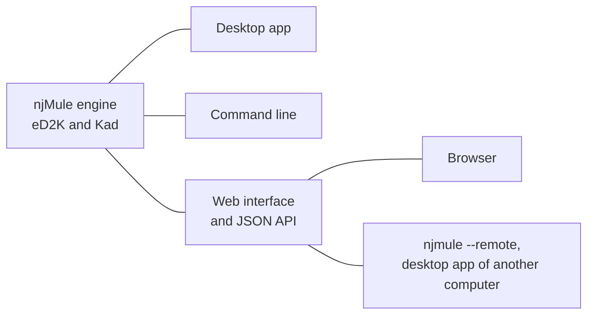

njMule, for *Next generation Java Mule*, is a modern, open-source client for the eD2K and Kad 2
file-sharing networks. It speaks the same protocols as eMule, so it works with the existing eMule
network: it connects to the same servers and Kad nodes, searches, downloads and uploads with eMule
and the other compatible clients, and can take an existing eMule profile over.

njMule is an independent project, licensed under the GNU General Public License, version 3 or later.
It is not affiliated with or endorsed by the eMule project.

## One engine, four ways to use it

Everything njMule does happens in one engine, which knows nothing of windows. Around it:

- **the desktop app**, for Windows, macOS and Linux, with themes, 36 languages and keyboard
  shortcuts;
- **the headless engine and its command line**, `njmule`, for a server, a NAS or a script;
- **the web interface**, the desktop app in a browser, behind a password;
- **the remote-control API**, in JSON, which the command line and the desktop app can also use to
  drive an njMule on another computer.

njMule is shipped as native executables, built with GraalVM: you install it like any other
program, and **no Java is needed**. There are installers and archives for Windows, macOS and Linux,
a Docker image and a Synology package.

## Who it is for

- **eMule users** who want a client that looks and works like today's apps, on Windows, macOS or
  Linux, and keeps their servers, contacts, credits and downloads.
- **People who run a server or a NAS** and want a client that runs without a window, starts with
  the system and is used from a browser.
- **Those who automate**: the command line and the API let scripts search, add downloads and watch
  what happens.

## Project status

njMule is in **pre-release**: the current version is `0.0.1-alpha.1`, a test version. It works on
the real networks, but features, options and file formats may still change before 1.0.0, and bugs
are to be expected. Packages are published on the
[GitHub releases page](https://github.com/njMule/njMule/releases); you can also
[build njMule from source](/developer/building). What changed recently is in the
[changelog](about/changelog.mdx).

## Use it legally

njMule is a tool for sharing files. Share and download only files you have the right to: your own
work, free software, works in the public domain or under a license that allows sharing. In many
countries, sharing or downloading copyrighted works without permission is against the law. You are
responsible for what you share and download; the njMule project hosts no files and has no control
over what others share.

## How this guide is organised

- **[Features](features.mdx)**: a tour of everything njMule does.
- **Getting started**: the [requirements](getting-started/requirements.mdx); installing on
  [Windows](getting-started/install-windows.mdx), [macOS](getting-started/install-macos.mdx),
  [Linux](getting-started/install-linux.mdx), with [Docker](getting-started/install-docker.mdx) or
  on [Synology](getting-started/install-synology.mdx);
  [verifying a download](getting-started/verify-downloads.mdx); the
  [first start](getting-started/first-run.mdx);
  [importing an eMule profile](getting-started/import-emule.mdx); and
  [your first download](getting-started/first-download.mdx).
- **[Desktop app](desktop/interface.mdx)**: every screen of the desktop app, from the
  [transfers](desktop/transfers.mdx) and the [search](desktop/search.mdx) to the
  [keyboard shortcuts](desktop/keyboard-shortcuts.mdx).
- **[Options](settings/index.mdx)**: every option, page by page.
- **[Web interface](web/overview.mdx)**: using njMule from a browser, its
  [security](web/security.mdx), [reverse proxies](web/reverse-proxy.mdx) and the
  [guest access](web/guest.mdx).
- **[Headless and servers](server/headless.mdx)**: the [command line](server/cli.mdx), the
  [remote-control API](server/remote-control.mdx), the [Windows service](server/windows-service.mdx)
  and the [Linux service](server/linux-service.mdx).
- **[Networking](network/ports.mdx)**: ports, servers and Kad, IPv6, connections through routers,
  obfuscation, proxies, network interfaces and the IP filter.
- **[Your data](data/locations.mdx)**: where njMule keeps its files, the portable mode, backups,
  logs, privacy and removing your profile.
- **[Updates](updates.mdx)**, **[Uninstall](uninstall.mdx)**,
  **[Troubleshooting](troubleshooting.mdx)**, **[FAQ](faq.mdx)** and the
  **[Glossary](glossary.mdx)** of eD2K and Kad terms.
- **About**: the [license](about/license.mdx), the [changelog](about/changelog.mdx) and how to
  report a [security issue](about/security.mdx).

The **[developer guide](/developer)** explains how to build njMule, test it, contribute and use
the API from your own programs.

## Getting help

Look first in [Troubleshooting](troubleshooting.mdx) and the [FAQ](faq.mdx). For a bug or a
question they do not answer, open an issue on
[GitHub](https://github.com/njMule/njMule/issues).
