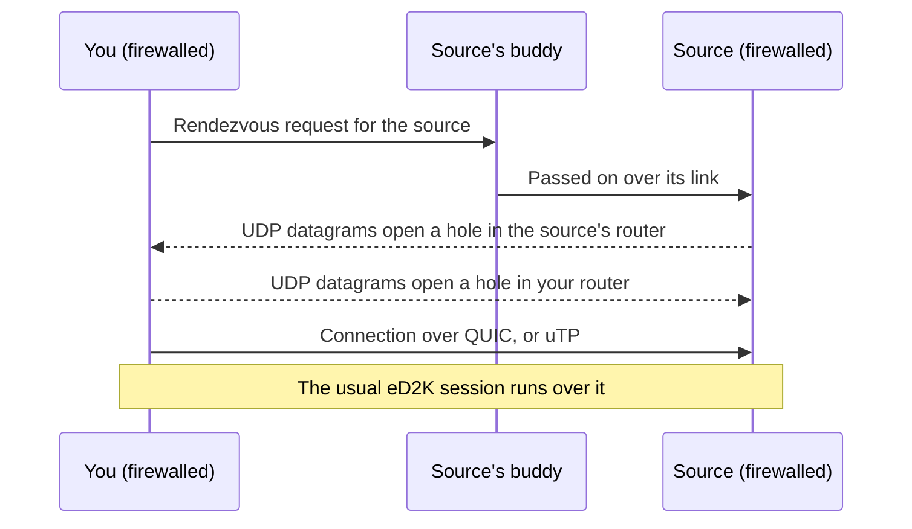

A client behind a router or firewall that does not let connections in has a LowID on eD2K and is
firewalled on Kad. The networks have long had ways around that, **callbacks**, but they need one
of the two sides to be reachable. njMule adds a way for **two firewalled clients** to connect
through their routers, over QUIC or uTP on the UDP port. It is on by itself whenever it can work;
there is nothing to set up.

## Callbacks

A callback turns the connection around: the client that cannot be reached is asked to connect to
the one that can.

- **Through the eD2K server**: when you have a HighID and a source with a LowID is on the same
  server, njMule asks the server, which tells the source to connect to you. With a LowID, it is
  the other way round: the server tells you that a client wants you, and njMule connects to it and
  answers its requests over that connection.
- **Through Kad**: a firewalled Kad source is asked to connect to you through its
  [buddy](./servers-and-kad.mdx#buddies), or directly over UDP when its UDP port is open. Other
  clients reach you the same ways while you are firewalled, and njMule's Kad source publishes say
  which way works.

Callbacks fail when **both** sides are firewalled: neither can accept the other's connection. That
is where NAT traversal comes in.

## Two firewalled clients

When you are firewalled yourself (a LowID and firewalled on Kad) and want to download from a
firewalled Kad source that has a buddy and takes such connections, njMule meets it through the
routers:

1. njMule sends a rendezvous request to the source's buddy, which passes it on to the source.
2. Both sides send datagrams to each other from their UDP port. Each router, seeing a datagram go
   out, then lets the answers in: a "hole" opens. Routers that change the port outside are
   allowed for: the ports near the one expected are tried too.
3. njMule opens the connection through the holes, and the eD2K session (file requests, queue,
   transfer) runs over it as over TCP. A connection that does not open within 25 seconds is given
   up.

As the source, the same happens the other way: your buddy passes a rendezvous on to you, njMule
sends datagrams back and takes the connection from the address the other client was seen at. And
while your UDP port is reachable (Kad says **UDP open**), other clients can open such connections
to you directly, even if your TCP port is closed.

### QUIC or uTP

- **QUIC** is used when the other client offers it: the connection is encrypted with TLS 1.3, and
  each side first proves its user hash before the session starts.
- **uTP** is the fallback: a reliable stream over UDP with selective acknowledgements and LEDBAT
  congestion control, which yields to your other traffic.

After a failed QUIC connection with a client, njMule uses uTP with it for two minutes.

Your hello and your Kad publishes tell other clients that you take such connections, only while
you do (see below); they follow a change of obfuscation or proxy at once. Only
clients that support it can use it; njMule does, so two njMule users behind routers can trade
with each other.

## What you see

The **Ports** card at the top of **Network**, in the desktop app and in the web interface, says
**NAT traversal: Yes** while it can be used, and **No** otherwise. Sources met this way show in
the transfers as any other; nothing else changes.

<Screenshot
    id="kad"
    alt="The network screen with the Kad view: the Ports card at the top right reads TCP 25955 · UDP 24078, UPnP is off and NAT traversal Yes"
    caption="The Ports card tells whether NAT traversal is on"
/>

## When it is not used

| Situation | Why |
|---|---|
| Kad is off | The meeting goes through Kad buddies, and the UDP port is Kad's. |
| [Obfuscation](./obfuscation.mdx) is **Required** | These connections are not obfuscated the eD2K way, which **Required** forbids. |
| A [proxy](./proxy.mdx) is set | The other client would see the proxy's address, not yours. |
| You are reachable | A plain connection or a callback works, so none is needed. |

Forwarding your ports (see [Ports](./ports.mdx)) remains the better fix: a reachable client gets
every source, not only those that support NAT traversal.

## Related pages

- [Ports and firewalls](./ports.mdx)
- [Servers and Kad](./servers-and-kad.mdx)
- [IPv6](./ipv6.mdx)
