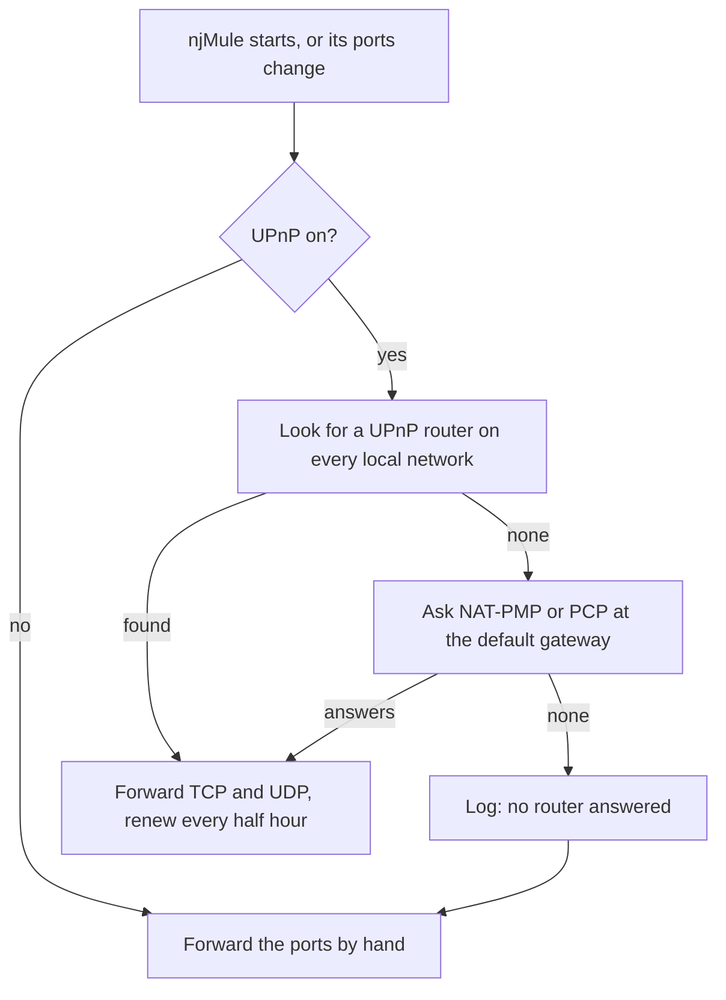

import Tabs from '@theme/Tabs';
import TabItem from '@theme/TabItem';

Other eD2K and Kad clients must be able to reach your computer to download from you and to
offer you their files. They do it through two ports, one TCP and one UDP. When your router or
firewall lets them through, you are **reachable from outside**: servers give you a HighID, Kad
calls you open, and you get more sources and faster downloads. This page explains which ports
njMule uses, how to tell whether they are open, and how to open them.

## The ports njMule uses

| Port | Default | Preference | What it is for |
|---|---|---|---|
| **Client Port (TCP)** | 4662 | `net.tcpPort` | Other clients connect to you here; servers and Kad nodes check it to decide whether you are reachable. |
| **UDP** | 4672 | `net.udpPort` | Kad, and the small UDP messages between clients (asking a source again for your place in its queue, callbacks, [NAT traversal](./nat-traversal.mdx)). It is open only while Kad runs. |
| Server UDP | chosen at each start | none | Pings, global searches and source requests sent to servers. Answers come back on the same port, so it needs no forwarding. |
| Web interface | 4711 | `webui.properties` | Only when you turn the web interface on. See [the web interface](../web/overview.mdx). |

Both client ports can be any number from 1 to 65535. The defaults are the ones eMule uses, so if
eMule (or a second njMule) runs on the same computer, give one of them other ports. If the TCP port
is taken, the log says `Cannot listen on TCP port …: other clients cannot connect, servers will
give a LowID`.

## HighID and LowID

When you connect to an eD2K server, the server tries to open a connection to your TCP port:

- If it gets through, you get a **HighID** (your public IPv4 address, written as a number). Any
  client can connect to you.
- If it does not, you get a **LowID**, an ID below 16,777,216. Clients cannot connect to you
  directly; they have to go through the server.

You see which one you have in the top bar (**High ID** or **Low ID** under the connection state),
on the **eD2K** card of the network (**Reachable from outside** or **Not reachable from
outside**, the technical term in its tooltip) and in **Network → Log → My Info**.

### What LowID means for you

njMule still works with a LowID, but less well:

- You can still connect to any client that has a HighID, so you can download from it.
- Other clients cannot connect to you on their own. A client on your server asks the server, which
  tells you to call it back; on Kad, your [buddy](./servers-and-kad.mdx#buddies) passes such
  requests on. See [callbacks](./nat-traversal.mdx#callbacks).
- Two LowID clients cannot connect through eD2K at all. Through Kad they can meet with
  [NAT traversal](./nat-traversal.mdx), when both clients support it.
- You therefore see fewer sources, downloads are slower, and fewer clients can download from you.

While no network you are connected to can reach you, the desktop app and the web interface show a
banner above the screens: **Others cannot reach you on port 4662 (LowID): open it in your router,
or turn on UPnP in the options.**, with a button that opens the options.

## Firewalled on Kad

Kad checks your ports in its own way: other Kad nodes are asked to connect to your TCP port and
to send a datagram to your UDP port. Both checks run when Kad starts, every hour and whenever you
click **Recheck Firewall**.

- **Open**: other nodes reach you; the **Kad** card says **Reachable from outside**.
- **Firewalled**: your TCP port is closed. The card says **Not reachable from outside** and, once
  the UDP test has run, **UDP open** or **UDP firewalled**. With UDP open, other clients can still
  ask you to call them back directly.
- Firewalled on both ports, njMule finds a **buddy**, an open Kad node that keeps a link to you
  and relays the callback requests of other clients. See
  [Servers and Kad](./servers-and-kad.mdx#buddies).

The Kad screen says it in words too: **Kad is on, but other nodes cannot reach you on port 4662:
open it in your router, or turn on UPnP in the options.**

## When your address changes

Many home connections get a new public address now and then. Once the server and Kad have seen
you at the same address, njMule notices when one of them sees you at another: a new address seen
by the server makes Kad check its firewall again, and one seen by Kad makes njMule log in to the
server again, so that both know where to reach you. The log says so, for example `Our public
address changed from 198.51.100.7 to 203.0.113.42: Kad checks its firewall again`.

## The network cards

The top of **Network** holds three cards, each with what to do next:

| Card | What it says | Its buttons |
|---|---|---|
| **eD2K** | Reachable or not (HighID or LowID), the server, its users and files | **Connect** / **Disconnect**, **Choose another server…** |
| **Kad** | Reachable or not (open or firewalled), the contacts, the UDP state | **Connect** / **Disconnect**, **Recheck Firewall** |
| **Ports** | `TCP 4662 · UDP 4672`, whether **UPnP** is on, your IPv6 address when you have one, whether **NAT traversal** is on | **Test the ports**, **Options** |

<Screenshot
    id="servers"
    alt="The network screen: the eD2K card says Reachable from outside on the server Lighthouse, the Kad card Reachable from outside with 1,243 contacts, the Ports card TCP 25955 · UDP 24078 with UPnP No and NAT traversal Yes"
    caption="The eD2K, Kad and Ports cards at the top of the network"
/>

The web interface shows the same three cards at the top of its **Network** page, with your public
IPv4 address on the **Ports** card as well.

## Port test

**Test Ports** finds out whether others reach you, without waiting for the next login. You find it
in three places: on the **Ports** card (**Test the ports**), in **Options → Connection → Ports**,
and on the **Connection** page of the first-start wizard. In the options and in the wizard the
ports typed in the fields are applied first.

The test then:

1. asks the router again through UPnP, when UPnP is on (it waits up to 15 seconds for an answer);
2. connects to the server again (the one you are on, or any known server), which checks your TCP
   port at login;
3. has Kad check both ports again, when Kad runs.

Each line shows its outcome as it comes, for at most three minutes:

| Line | Meaning |
|---|---|
| **The router at 192.168.1.1 forwards the ports** | UPnP, NAT-PMP or PCP opened the ports. |
| **The router at 192.168.1.1 forwards only some of the ports** / **refused to forward the ports** | The router answered but said no; the log names each port and the router's reason. |
| **No router answered through UPnP** / **The router did not answer UPnP properly** | Forward the ports by hand. |
| **UPnP is off** | You forward the ports yourself. |
| **TCP 4662: others reach it** | Open. |
| **TCP 4662: others cannot reach it; forward it in the router or allow it in the firewall** | Closed. |
| **TCP 4662: not tested, as no server or Kad node could do it** | No server was reachable and Kad is off or not connected. |
| **UDP: not tested, Kad is off** | Only Kad tests the UDP port. |

Kad's UDP test may take a few minutes. The log also says `Testing the ports: TCP 4662, UDP 4672`.

## Change the ports

1. Open **Options → Connection**.
2. Under **Ports**, type the new **Client Port (TCP)** and **UDP** port.
3. Click **Apply and reconnect** in the bar under the page.

njMule listens on the new ports at once, logs in to the server again so that it learns the new TCP
port, restarts Kad and asks the router again. No restart is needed. If the ports were forwarded by
hand, change the forwarding in the router too.

<Screenshot
    id="settings-pending"
    alt="Options, Connection page: the client port changed to 4777 and marked Changed, and a bar at the bottom saying that ports, UPnP, the proxy and the network interface take effect when njMule reconnects, with Discard and Apply and reconnect"
    caption="New ports wait for Apply and reconnect"
/>

Without the desktop app, change them in the web interface (**Options → Connection**), through the
[remote-control API](../server/remote-control.mdx), or in `njmule.properties` while njMule is
stopped:

```properties
net.tcpPort=4662
net.udpPort=4672
```

## Forwarding with UPnP

**Forward the ports with UPnP** (on by default, `net.upnp`) has njMule ask your router to forward
its ports while it runs. Most home routers allow it.



- njMule looks for a UPnP router on every local network of the computer (virtual adapters of
  WSL, Hyper-V or a VPN do not hide it) and waits three seconds for an answer.
- A router that does not speak UPnP is asked through **NAT-PMP**, or **PCP**, its successor, at the
  default gateway (port 5351), read from the system's routing table.
- The TCP port is forwarded always, the UDP port while Kad runs. The mappings are named `njMule`,
  leased for an hour and renewed at half the lease the router grants, which also recreates a
  mapping the router lost. A router that only keeps permanent mappings gets permanent ones.
- With NAT-PMP and PCP a mapping counts only when the router keeps the same port outside, since
  that is the port the networks are told.
- When njMule exits, it removes the mappings it made, and only those.

The log tells the outcome, for example `UPnP: TCP 4662 and UDP 4672 forwarded by 192.168.1.1`,
`UPnP: the router at 192.168.1.1 refused TCP 4662 (…)` or `UPnP, NAT-PMP and PCP: no router
answered`.

### IPv6 pinholes

When you have a public [IPv6 address](./ipv6.mdx), nothing translates it, but the router may still
have an IPv6 firewall. njMule asks it to let clients in to the same two ports at your IPv6
address: through UPnP (IGDv2 pinholes) when the router offers them, otherwise through PCP at the
IPv6 default gateway. The pinholes are renewed with the mappings, follow a change of your IPv6
address and are closed on exit.

## Forwarding by hand

If your router has no UPnP, NAT-PMP or PCP, or you prefer to keep them off:

1. Give the computer a fixed address on your network, usually a DHCP reservation in the router,
   so that the forwarding keeps pointing at it. Note that address (for example `192.168.1.20`).
2. In the router's port forwarding page (its name varies: *Port forwarding*, *Virtual server*,
   *NAT*), forward **TCP** port 4662 and **UDP** port 4672 to that address, the same port numbers
   outside and inside.
3. Allow the ports in the computer's firewall (see below).
4. Turn **Forward the ports with UPnP** off if you like, click **Apply and reconnect**, then
   **Test Ports**.

<Tabs groupId="os">
  <TabItem value="windows" label="Windows" default>

Windows Defender Firewall asks whether njMule may accept connections the first time it listens:
allow it on private networks. The Windows service adds its own rule, for private and domain
networks (see [Windows service](../server/windows-service.mdx)).

  </TabItem>
  <TabItem value="macos" label="macOS">

If the macOS firewall is on, allow incoming connections for njMule when macOS asks, or add it in
*System Settings → Network → Firewall → Options*.

  </TabItem>
  <TabItem value="linux" label="Linux">

With ufw:

```bash
sudo ufw allow 4662/tcp
sudo ufw allow 4672/udp
```

With firewalld:

```bash
sudo firewall-cmd --permanent --add-port=4662/tcp --add-port=4672/udp
sudo firewall-cmd --reload
```

  </TabItem>
</Tabs>

:::note[Behind a provider's NAT]
Some providers put several customers behind one public address (carrier-grade NAT; the router's
WAN address is then a private one, often in `100.64.0.0/10`). No forwarding in your router can
make you reachable then. You keep a LowID and are firewalled on Kad; buddies, callbacks and
[NAT traversal](./nat-traversal.mdx) still let you trade with most clients. A public IPv6 address,
when you have one, is reachable without NAT.
:::

## Docker, NAS and services

- **Docker**: publish both ports, `-p 4662:4662/tcp -p 4672:4672/udp`, and forward them in the
  router to the host. Ports changed in the options are published unchanged (`-p 5000:5000/tcp`).
  UPnP does not cross Docker's bridge network; it works with `--network host`. See
  [Docker](../getting-started/install-docker.mdx).
- **Synology**: the DSM firewall lists njMule's ports as services, 4662/tcp (eD2K) and 4672/udp
  (eD2K and Kad), besides 4711/tcp for the web interface. The router forwards the first two to
  the NAS, or UPnP asks it to. If you change the ports in the options, allow the new ones in the
  DSM firewall yourself. See [Synology](../getting-started/install-synology.mdx).
- **Network interface**: when njMule is bound to a VPN, the ports must be open at the VPN, not in
  your home router. See [Binding to an interface](./bind-interface.mdx#port-forwarding-with-a-vpn).

## Related pages

- [Connection options](../settings/connection.mdx)
- [Servers and Kad](./servers-and-kad.mdx)
- [NAT traversal](./nat-traversal.mdx)
- [IPv6](./ipv6.mdx)
- [Troubleshooting](../troubleshooting.mdx)
