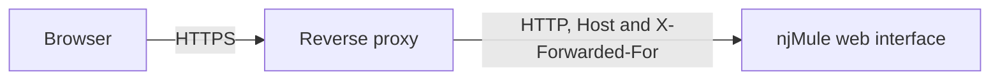

import Tabs from '@theme/Tabs';
import TabItem from '@theme/TabItem';

njMule's web interface speaks plain HTTP. To reach it from outside your home, or simply to have
HTTPS with a real certificate and a name such as `njmule.example.com`, put a reverse proxy in front
of it: the proxy serves HTTPS to the browsers and passes the requests on to njMule.



## What njMule needs

1. **Its public name, listed.** Against DNS rebinding the interface answers only names it knows
   (see [Host names](./security.mdx#host-names)). List the proxy's public name with
   `--webui-host njmule.example.com`, or in **Options → Web Interface → Host names** of the desktop
   app on njMule's computer; a browser cannot change the web interface's settings.
2. **The browser's host name in the `Host` header.** Traefik and Caddy pass it on as it is; nginx
   needs `proxy_set_header Host $host;`, otherwise it sends the address of its upstream.
3. **The root of a name, or a path the proxy strips.** The pages link to one another, to their
   files and to the API relative to themselves, so the interface works at
   `https://njmule.example.com/` and at `https://example.com/njmule/` alike, as long as the proxy
   removes `/njmule` before passing the request on. Open such an address with its last slash.
4. **Optionally, the proxy trusted to name its client**, so that the lockout after wrong passwords
   counts each user apart (see [Trusted proxies](#trusted-proxies)).

The rest takes care of itself:

- Forms are taken from the listed name on any port, over HTTP or HTTPS, so the proxy may serve
  HTTPS on 443 while njMule listens on 4711.
- The session cookie is `Secure` when the browser logged in over HTTPS: njMule sees it in the
  browser's own `Origin`, so no `X-Forwarded-Proto` header is needed, nor trusted.
- The live notices are a stream of server-sent events that sends a keep-alive every 15 seconds;
  the proxy must pass it on without buffering it (nginx needs `proxy_buffering off;`).

:::tip[Where njMule listens]
When the proxy runs on the same computer, keep LAN access off: njMule then listens on `127.0.0.1`
only and the proxy is the only way in. In Docker, or when the proxy is on another machine, turn LAN
access on (`--webui-lan`) and do not publish the interface's port anywhere else.
:::

## Set njMule up

On the computer that runs njMule, with the proxy on the same computer:

```bash
njmule --webui-password --webui-host njmule.example.com --webui-proxy 127.0.0.1
```

`--webui-password` asks for the password; LAN access stays off. Restart njMule to apply it. The
same can be done in the desktop app's **Options → Web Interface** (**Host names** and **Trusted
proxies**) on njMule's computer, where it applies at once.

## Example configurations

Each example serves `njmule.example.com` over HTTPS and passes the requests to njMule on port
4711. Replace the name, the certificate paths and the addresses with yours.

<Tabs groupId="proxy">
<TabItem value="nginx" label="nginx" default>

```nginx
server {
    listen 443 ssl;
    listen [::]:443 ssl;
    server_name njmule.example.com;

    ssl_certificate     /etc/letsencrypt/live/njmule.example.com/fullchain.pem;
    ssl_certificate_key /etc/letsencrypt/live/njmule.example.com/privkey.pem;

    location / {
        proxy_pass http://127.0.0.1:4711;
        proxy_http_version 1.1;
        proxy_set_header Connection "";
        # njMule checks the name the browser asked for.
        proxy_set_header Host $host;
        # The client's address, which njMule reads when it trusts this proxy.
        proxy_set_header X-Forwarded-For $proxy_add_x_forwarded_for;
        # The live notices: pass the events on as they come.
        proxy_buffering off;
        proxy_read_timeout 1h;
    }
}

server {
    listen 80;
    listen [::]:80;
    server_name njmule.example.com;
    return 301 https://$host$request_uri;
}
```

njMule: `--webui-host njmule.example.com --webui-proxy 127.0.0.1`.

</TabItem>
<TabItem value="caddy" label="Caddy">

```text
njmule.example.com {
    reverse_proxy 127.0.0.1:4711
}
```

Caddy gets and renews the certificate by itself, redirects HTTP to HTTPS, passes the `Host` header
on, sets `X-Forwarded-For` and streams server-sent events without buffering them.

njMule: `--webui-host njmule.example.com --webui-proxy 127.0.0.1`.

</TabItem>
<TabItem value="traefik" label="Traefik (Docker)">

Traefik and njMule in one Compose file: Traefik takes a fixed address on a network of their own,
so that njMule trusts that one address only. The interface's port is not published: Traefik is
the only way in.

```yaml
services:
    traefik:
        image: traefik:v3
        command:
            - --providers.docker=true
            - --providers.docker.exposedbydefault=false
            - --entrypoints.web.address=:80
            - --entrypoints.web.http.redirections.entrypoint.to=websecure
            - --entrypoints.websecure.address=:443
            - --certificatesresolvers.le.acme.tlschallenge=true
            - --certificatesresolvers.le.acme.email=you@example.com
            - --certificatesresolvers.le.acme.storage=/letsencrypt/acme.json
        ports: ["80:80", "443:443"]
        volumes:
            - /var/run/docker.sock:/var/run/docker.sock:ro
            - letsencrypt:/letsencrypt
        networks:
            proxy:
                ipv4_address: 172.30.0.2
    njmule:
        image: ghcr.io/njmule/njmule:latest
        restart: unless-stopped
        stop_grace_period: 30s
        # Replaces the image's own arguments: the password file comes first again.
        command:
            - --webui-password-file
            - /run/secrets/njmule_webui_password
            - --webui-lan
            - --webui-host
            - njmule.example.com
            - --webui-proxy
            - 172.30.0.2
        ports: ["4662:4662/tcp", "4672:4672/udp"]
        volumes:
            - njmule:/njmule
            - ./incoming:/njmule/incoming
        secrets: [njmule_webui_password]
        networks: [proxy]
        labels:
            - traefik.enable=true
            - traefik.http.routers.njmule.rule=Host(`njmule.example.com`)
            - traefik.http.routers.njmule.entrypoints=websecure
            - traefik.http.routers.njmule.tls.certresolver=le
            - traefik.http.services.njmule.loadbalancer.server.port=4711
networks:
    proxy:
        ipam:
            config:
                - subnet: 172.30.0.0/24
volumes:
    njmule:
    letsencrypt:
secrets:
    njmule_webui_password:
        file: ./webui_password.txt
```

Traefik passes the `Host` header on and adds the client to `X-Forwarded-For`. The image starts
with `--webui-password-file` at every start, and a browser cannot change the web interface's
settings, so the host name and the proxy are given in `command`, each time.

</TabItem>
</Tabs>

### A proxy in front of Docker

When the proxy runs on the host and njMule in a container with its port published
(`-p 4711:4711`), the requests reach njMule from Docker's bridge, usually `172.17.0.1`:

```bash
docker run -d --name njmule --restart unless-stopped --stop-timeout 30 \
    -p 4662:4662/tcp -p 4672:4672/udp -p 127.0.0.1:4711:4711/tcp \
    -v njmule:/njmule -v ~/njmule/incoming:/njmule/incoming \
    -v ~/njmule/webui_password:/run/secrets/njmule_webui_password:ro \
    ghcr.io/njmule/njmule \
    --webui-password-file /run/secrets/njmule_webui_password --webui-lan \
    --webui-host njmule.example.com --webui-proxy 172.17.0.1
```

Publishing the port on `127.0.0.1` only keeps other computers from reaching it past the proxy.
See [Docker](../getting-started/install-docker.mdx) for the rest of the container's set-up.

## Under a path

To serve the interface at `https://example.com/njmule/` beside other sites, let the proxy strip
`/njmule` before passing the request on:

<Tabs groupId="proxy">
<TabItem value="nginx" label="nginx" default>

```nginx
location /njmule/ {
    # The last slash replaces /njmule/ with / on the way to njMule.
    proxy_pass http://127.0.0.1:4711/;
    proxy_http_version 1.1;
    proxy_set_header Connection "";
    proxy_set_header Host $host;
    proxy_set_header X-Forwarded-For $proxy_add_x_forwarded_for;
    proxy_buffering off;
    proxy_read_timeout 1h;
}
```

nginx also redirects `/njmule` to `/njmule/`.

</TabItem>
<TabItem value="caddy" label="Caddy">

```text
example.com {
    redir /njmule /njmule/ 308
    handle_path /njmule/* {
        reverse_proxy 127.0.0.1:4711
    }
}
```

</TabItem>
<TabItem value="traefik" label="Traefik (Docker)">

```yaml
labels:
    - traefik.enable=true
    - traefik.http.routers.njmule.rule=Host(`example.com`) && PathPrefix(`/njmule/`)
    - traefik.http.routers.njmule.entrypoints=websecure
    - traefik.http.routers.njmule.tls.certresolver=le
    - traefik.http.middlewares.njmule-strip.stripprefix.prefixes=/njmule
    - traefik.http.routers.njmule.middlewares=njmule-strip
    - traefik.http.services.njmule.loadbalancer.server.port=4711
```

</TabItem>
</Tabs>

List `example.com` as the host name. A path that is not stripped does not work: njMule serves its
pages at the root only.

:::note
The session cookie applies to the whole name (its path is `/`), so other applications served under
the same name receive it too. When you do not trust them all, give njMule a name of its own.
:::

## Trusted proxies

Behind a proxy every request comes from the proxy's address. The lockout after
[failed logins](./security.mdx#failed-logins) then holds for all your users at once: five wrong
passwords from anyone lock everyone out for a minute, and the log names the proxy instead of the
client.

Name the proxy as trusted and njMule believes its `X-Forwarded-For` header:

```bash
njmule --webui-password --webui-host njmule.example.com --webui-proxy 127.0.0.1
njmule --webui-password --webui-lan --webui-proxy 192.0.2.5,2001:db8::5
njmule --webui-password --webui-lan --webui-proxy 10.0.0.0/8 --webui-proxy 10.1.0.1-10.1.0.9
```

- A proxy is an IP address, a CIDR block or a range of addresses, IPv4 or IPv6; never a host name.
  Repeat the option or separate the entries with commas. In the desktop app they go in **Options →
  Web Interface → Trusted proxies**. None is trusted by default.
- Only a request whose own address is trusted has its header read. njMule reads it from the right,
  skipping the trusted proxies, and takes the first other address as the client, so that an
  address the browser itself put in the header is never believed. From any other address the
  header is ignored.
- Each client then has its own login attempts (an IPv6 client per /64 network), its own API token
  attempts, and its address in the log.

:::warning
Trust only the proxy in front of njMule. Whoever can send requests from a trusted address can
claim to be any client and escape the lockout; a wide block such as `172.16.0.0/12` trusts every
container of every Docker network.
:::

## Check it works

1. Open `https://njmule.example.com/` and log in.
2. *Unknown host name* means the name is not listed, or the proxy does not pass the browser's
   `Host` on.
3. *Cross-site request refused.* at login means the proxy sends another `Host` than the name in the
   browser's address bar, and that name is not listed.
4. Notices of finished downloads that come late, or all at once, mean the proxy buffers the event
   stream.
5. After a wrong password, njMule's log should name your own address, not the proxy's.

The [remote-control API](../server/remote-control.mdx), once turned on, works through the proxy
too: with its token in `NJMULE_API_TOKEN`, run
`njmule --remote-url https://njmule.example.com/api/v1 --remote status`.

## Related pages

- [Web interface security](./security.mdx)
- [Web interface](./overview.mdx)
- [Docker](../getting-started/install-docker.mdx)
- [Web interface options](../settings/web-interface.mdx)
